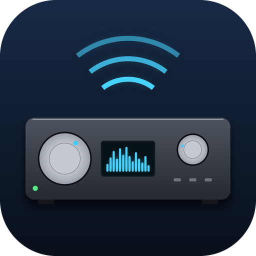

# Denon AVR (Indigo plugin)

An [Indigo](https://www.indigodomo.com) plugin for Denon and Marantz network AV receivers, plugin id
`com.vtmikel.denon`. It is built on [denonavr](https://github.com/ol-iver/denonavr), the library
behind Home Assistant's Denon integration, and can take over the devices and automations of the
older Cynical Denon plugin (see [Moving from Cynical Denon](#moving-from-cynical-denon)).

**Supported receivers:** Denon and Marantz network receivers supported by `denonavr`. Tested on
the Denon AVR-X3700H. Home Assistant's Denon AVR integration documentation lists models known to
work with the library; other models should work but have not been verified. Reports of working
(or not working) models are welcome as GitHub issues.

Not yet listed in the Indigo Plugin Store.

## What it does

- Live updates over the receiver's telnet connection (port 23): power, input, volume and mute
  change in Indigo the moment they change on the receiver.
- On every connect, and every few minutes (plugin setting, default 5), it re-reads every zone and
  writes **every** value, including "off", so a change made while Indigo was down is corrected.
- If telnet is unavailable it keeps working over HTTP: commands go through the receiver's web
  interface and status is read back the same way.

The receiver accepts **one** telnet connection. Do not point a second client at it over telnet
(for example Home Assistant's Denon integration with "use telnet" enabled).

## Devices

| Type | What it is | Configure |
| --- | --- | --- |
| **Receiver (main zone)** `receiver` | The receiver and its main zone | IP address or host name |
| **Zone (Zone 2 / Zone 3)** `zone` | A secondary zone | Its receiver, and the zone number |

States (both types unless noted):

| State | Values |
| --- | --- |
| `state` | `on`, `off`, `unavailable` (display state). Indigo also provides `state.on`, `state.off`, `state.unavailable` as true/false. `unavailable` = the receiver cannot be reached at all. |
| `power` | true/false |
| `source` | The receiver's input code: `SAT/CBL`, `CD`, `BD`, `MPLAY`, ...; zones also `SOURCE` (follow the main zone) |
| `source_name` | The input's name as renamed on the receiver (e.g. "Living Room Apple TV") |
| `volume` | dB, -80 to 18 |
| `muted` | true/false |
| `connected` | receiver only: the live telnet connection is up |
| `model` | receiver only: e.g. "Denon AVR-X3700H" |

## Actions

Power (on/off/toggle), Select Input (from the receiver's list, or any input code), Set Volume (dB;
variable substitution works), Volume Up / Down, Mute (on/off/toggle), Refresh Status, and Send Raw
Command (any Denon/Marantz protocol command, e.g. `PSDYNVOL MED`).

From a script:

```python
denon = indigo.server.getPlugin("com.vtmikel.denon")
denon.executeAction("set_volume", deviceId=ZONE2_DEVICE_ID, props={"volume": "-46"})
denon.executeAction("set_power", deviceId=ZONE2_DEVICE_ID, props={"value": "on"})
```

## Installing

Download the plugin, double-click `Denon AVR.indigoPlugin` on the Indigo server Mac, then create a
**Receiver** device with the receiver's IP address (and a **Zone** device per extra zone). On its
first start Indigo installs the pinned Python libraries from
`Contents/Server Plugin/requirements.txt`, so the Mac must be able to reach pypi.org then.

## Moving from Cynical Denon

`tools/migrate_from_cynical_denon.py` moves existing Cynical Denon devices and action steps onto
this plugin by editing the Indigo database while the Indigo server is stopped. Device ids stay the
same, so triggers, conditions, scripts and other plugins that refer to the devices keep working.
State names are compatible (`power`, `source`, `volume`, `muted`, `state.on`, `state.unavailable`).
Only the action types Power, Select Source and Audio Volume are migrated; the tool stops if it
finds any other Cynical Denon action.

Back up your database first. Then:

1. Dry run on a copy and read the diff:
   `python3 tools/migrate_from_cynical_denon.py Home.indiDb --output /tmp/Home.migrated > /tmp/denon.diff`
2. Install this plugin (no devices yet). Quit the Indigo client and stop the server
   (`/usr/local/indigo/indigo-stop`).
3. `python3 tools/migrate_from_cynical_denon.py ~/Documents/Home.indiDb --in-place --expect-devices N --expect-steps N --expect-reloads N`
   with the counts the dry run reported. It refuses to run while the server is running and keeps
   `Home.indiDb.pre-denon-migration-<time>`.
4. Move `Cynical Denon.indigoPlugin` to `Plugins (Disabled)`, start the server
   (`/usr/local/indigo/indigo-start`) and open the client.

Rollback: stop the server, copy the backup over the database, move Cynical Denon back, start.

## Development

```bash
python3 -m venv .venv && .venv/bin/pip install -r requirements.txt -r "Denon AVR.indigoPlugin/Contents/Server Plugin/requirements.txt"
.venv/bin/black . && .venv/bin/ruff check --select E9,F . && .venv/bin/python -m pytest
```

The icon is drawn by `tools/make_icon.py` (needs Pillow).

## License

MIT, see [LICENSE](LICENSE).
